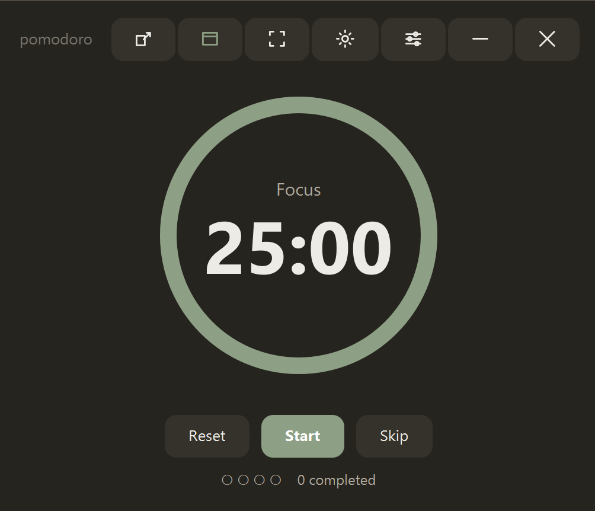

# Pomodoro

A clean, minimal desktop Pomodoro timer in warm earth tones (greige + sage),
built with **Java 21 + JavaFX** and packaged as a standalone Windows app.



## Features

- **Classic 25 / 5 / 15 timer** with a long break every 4 focus sessions, all
  adjustable in Settings. Progress dots track completed sessions.
- **Borderless window**: drag the top bar to move, resize from any edge or
  corner, and use the custom minimize / close buttons.
- **Light & dark mode** in matching earth-tone palettes, remembered between runs.
- **Three window modes**:
  - **Compact**: a tiny always-on-top pop-out showing only the timer, with
    digits that scale to the window size.
  - **Window**: a normal resizable window.
  - **Full**: fullscreen on the current monitor (`Esc` to exit).
- **Alarm takeover**: when a session ends, the app restores itself (even from
  minimized), jumps to the front, goes fullscreen, and pulses until you click
  to dismiss.
- **Global hotkeys** that work even when the app isn't focused:

  | Shortcut     | Action                 |
  |--------------|------------------------|
  | `Ctrl+Alt+P` | Start / pause          |
  | `Ctrl+Alt+M` | Cycle window mode      |
  | `Ctrl+Alt+R` | Reset current phase    |

- **Auto-start next session** (optional, in Settings).

Settings are saved to `~/.pomodoro/settings.properties`.

### Top bar

From left to right: **Compact**, **Window**, **Full**, **Theme**,
**Settings**, **Minimize**, **Close**.

## Building

### Requirements

- **JDK 21** on Windows (e.g. [Adoptium Temurin](https://adoptium.net/)).
  Edit the `JAVA_HOME` line in `run-dev.bat` / `build-exe.bat` if your JDK is
  installed somewhere else.
- No Maven install needed: the bundled Maven Wrapper (`mvnw.cmd`) downloads it
  on first run.
- Build the `.exe` **on Windows**, not WSL. `jpackage` targets the OS it runs
  on, so building from WSL produces a Linux app.

### Run in development

From cmd or PowerShell in the project folder:

```
run-dev.bat
```

Builds a fat jar and launches it with `java -jar`.

### Build the standalone app

```
build-exe.bat
```

Produces `dist\Pomodoro\Pomodoro.exe`, a self-contained app with its own
bundled Java runtime, so it runs on machines without Java installed.

> Want an `.msi` installer instead? Install the
> [WiX Toolset](https://wixtoolset.org/) and change `--type app-image` to
> `--type msi` in `build-exe.bat`.

## Project layout

```
pom.xml                         Maven build (JavaFX + shade)
build-exe.bat                   Build the standalone Windows app
run-dev.bat                     Quick dev run
src/main/java/com/pomodoro/
  Launcher.java                 Entry point (enables fat-jar JavaFX launch)
  App.java                      UI, window modes, alarm takeover
  PomodoroTimer.java            Timer state machine
  Settings.java                 Persisted settings
  GlobalHotkeys.java            System-wide hotkeys (jnativehook)
  WindowResizer.java            Edge/corner resizing for the borderless window
src/main/resources/styles.css   Light and dark themes
src/main/resources/icons/       App icon PNGs (taskbar/window)
packaging/icon.svg              Icon source
icon.ico                        Multi-resolution icon for the packaged .exe
docs/screenshot.png             README screenshot
```

### Regenerating the app icon

Edit `packaging/icon.svg`, then run (requires `rsvg-convert` and ImageMagick):

```
for s in 16 24 32 48 64 128 256; do rsvg-convert -w $s -h $s packaging/icon.svg -o src/main/resources/icons/icon-$s.png; done
magick src/main/resources/icons/icon-256.png -define icon:auto-resize=256,128,64,48,32,16 icon.ico
```

## Notes

Windows sometimes blocks apps from stealing focus from a fullscreen app. The
alarm takeover combines restore + always-on-top + fullscreen so it still
visibly takes over the screen in those cases.
